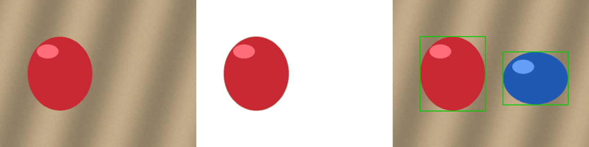

# 月5万円プロジェクト

目標: 週20時間で月5万円の副収入。専門は AI・画像処理。

- `imgbatch/` … ポートフォリオ兼・販売用の画像一括処理ツール(`python -m imgbatch 入力 出力 --max-width 1200 --format webp --trim`)
- `receipt_ocr/` … 領収書・レシート画像 → Excel/CSV(日付・店名・合計・勘定科目・要確認フラグ)
  - `python -m receipt_ocr samples out.xlsx`(`.csv` も可。`--rules my.json` で勘定科目ルールを差し替え)
  - 前処理で影除去・傾き補正。回転6°+影+ノイズを加えた検証画像で、旧処理は全項目失敗 → 新処理は日付・合計を正しく抽出(`tests/`)
  - Excel には合計行、科目別集計シート(SUMIF)、要確認行のハイライト付き
  - 要: `apt install tesseract-ocr tesseract-ocr-jpn`(Mac: `brew install tesseract tesseract-lang`)
  - `samples/` はダミー画像(生成スクリプト付き)。実在のレシートは含みません
- `objcut/` … 背景除去(透過PNG/白背景)と物体検出(枠描画)。モデルDL不要の GrabCut 方式
  - `python -m objcut samples/object1.png out --mode white`(`cutout` / `white` / `boxes`)
  - 
  - 合成データでの前景マスク IoU は約 0.98。実写の複雑な背景では精度が落ちるため、案件では事前に見本で確認します
- `docs/PLAN.md` … 4週間の行動計画と収益目標
- `docs/GIGS.md` … ココナラ等への出品文ドラフト
- `docs/PROPOSALS.md` … クラウドソーシング提案文テンプレート

テスト: `pip install -r requirements.txt && pytest`
